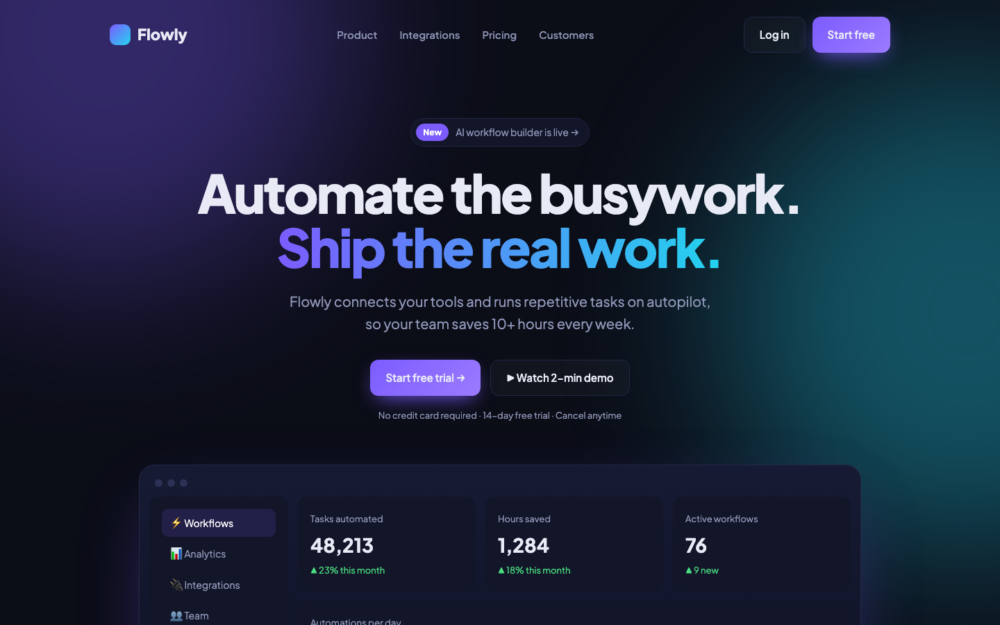

# Flowly — SaaS Landing Page

Modern dark-mode landing page for an AI workflow automation startup.

**🔗 Live demo: [https://chziya69.github.io/flowly-saas-landing/](https://chziya69.github.io/flowly-saas-landing/)**

## About this project
A design concept for a fictional brand (the business, names, prices and reviews are placeholder content), built to show my approach to **SaaS / startup** websites.

**What's inside:** Gradient hero with product dashboard mockup, feature grid, pricing table with highlighted plan, final CTA.

## Tech
- Hand-coded HTML & CSS, no frameworks or page builders
- Fully responsive (desktop, tablet, phone)
- Single lightweight file that loads instantly
- Google Fonts

[Full-page screenshot](full-page.png)

---

### Need a website like this?
I design and build fast, modern websites and landing pages (HTML/CSS, WordPress, Webflow, Shopify).

👉 **[Hire me on Upwork](https://www.upwork.com/freelancers/~011d30ba4386bdbcf8)**
